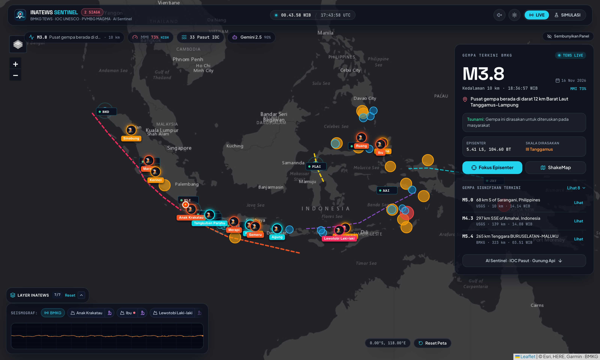

# INATEWS SENTINEL 🌊🌋⚡

<div align="center">

🏆 **3rd Prize: The Most Creative AI App — Confluent AI Day Indonesia 2026**

[](https://inatews-sentinel.vercel.app)
[](https://confluent.cloud)
[](https://flink.apache.org)
[](https://ai.google.dev)
[](https://go.dev)
[](https://nextjs.org)

<br/>

**Sistem Peringatan Dini Gunung Api, Gempa & Tsunami Indonesia — Real-Time Disaster Intelligence & Early Warning**

[**Live Tactical Dashboard ↗**](https://inatews-sentinel.vercel.app) · [**Architecture**](#architecture) · [**Megathrust Scenarios**](#autonomous-megathrust-scenarios) · [**Quick Start**](#setup--quickstart) · [**Delivery Script**](#delivery-script)

</div>

---

> ⚠️ **Important Scientific Disclaimer**:  
> INATEWS Sentinel provides real-time seismic correlation, tsunami wave anomaly detection, and rapid decision-support impact estimation for disaster response authorities (BMKG, BNPB, BASARNAS, KEMENHUB). It is **NOT** a deterministic earthquake prediction system.

---

<a id="live-dashboard"></a>

## 🛰️ Live Tactical Dashboard



*Real-time national tectonic map, live BMKG earthquake feeds, IOC UNESCO sea-level tide gauges, volcanic seismograph telemetry (Anak Krakatau, Lewotobi Laki-laki, Ibu, Merapi, Semeru), and autonomous Gemini AI tactical directive dispatch.*

---

<a id="architecture"></a>

## 🏛️ Architecture

```
                 REAL-TIME TELEMETRY DATA SOURCES
                                │
        ┌───────────────────────┼───────────────────────┐
        ↓                       ↓                       ↓
  Seismic Feeds          Satellite Feeds           Ocean Sensors
  (BMKG AutoGempa,       (InSAR Coseismic          (InaTEWS DART,
   USGS Global,           Surface Slip,             IOC Sea Level
   Broadband Stations)    Fault Creep)              Tide Gauges)
        ↓                       ↓                       ↓
        └────────────── CONFLUENT CLOUD ────────────────┘
                                │
                    Kafka Topics (gempa.*)
                                │
                        FLINK SQL ENGINE
                                │
                                ├── 01_create_tables.sql     (Unified Telemetry View)
                                ├── 02_activity_index.sql    (Real-Time National MMI)
                                ├── 03_correlated_alerts.sql (Multi-Hazard Correlation)
                                ├── 04_tsunami_detection.sql (Wave Anomaly Detection)
                                │
                    Aggregated Output Topics
                                │
                 ┌──────────────┴──────────────┐
                 ↓                             ↓
        Go Backend Engine             Google Gemini AI
      (Gin + Confluent Kafka)        (Gemini 2.5 Flash /
                 ↓                   Autonomous Agent OODA)
          SSE Live Stream                      ↓
                 ↓                    Multi-Agency Actions
        Next.js Dashboard ─────────► (BMKG, BNPB, BASARNAS,
      (Leaflet Tactical Map)              KEMENHUB)
```

---

<a id="core-capabilities"></a>

## ⚡ Core Capabilities

1. **Multi-Stream Event Telemetry**:
   - Continuous ingestion of BMKG official earthquake data (`autogempa`, `gempaterkini`, `gempadirasakan`) with USGS global fallback.
   - 33+ IOC UNESCO sea-level tide gauge stations monitoring anomalous water recession and tsunami runup waves.
   - Active volcanic monitoring (PVMBG MAGMA Indonesia) for Lewotobi Laki-laki, Anak Krakatau, Ibu, Semeru, Merapi, Sinabung, and Marapi.
   - Geodetic InSAR surface deformation tracking coseismic slip across Indonesia's major subduction zones.

2. **Real-Time Stream Correlation via Apache Flink SQL**:
   - Micro-window aggregations across heterogeneous sensor feeds.
   - Automated computation of the **National Seismic Intensity Index (MMI)** and Peak Ground Acceleration (PGA).
   - Instant wave correlation matching P-wave seismic arrivals with ocean buoy displacement.

3. **Dual AI Intelligence & Autonomous Streaming Data Agent**:
   - **Primary Engine**: **Google Gemini 2.5 Flash** for rapid, schema-grounded multi-agency threat matrices.
   - **Enterprise Secondary**: **AWS Bedrock (Anthropic Claude 3.5 Sonnet / Amazon Nova)** with runtime switching.
   - **Resilient Fallback**: Internal high-precision seismological heuristic engine ensures zero downtime during network or quota interruptions.
   - **Autonomous OODA Loop**: Ingests streaming Kafka events, tracks evolving threat state, and dispatches automated tactical directives for BMKG (sirens), BNPB (evacuation corridors), BASARNAS (rescue mobilization), and KEMENHUB (transit suspension).

4. **Tactical Mission-Control Cockpit**:
   - Zero-dependency client operation with instant offline/demo mock capabilities (`DEMO_MODE=true`).
   - Dynamic tectonic subduction plate boundaries and live seismograms.
   - Instant epicenter focusing and official BMKG ShakeMap inspector.

---

<a id="autonomous-megathrust-scenarios"></a>

## 🌊 Autonomous Megathrust Scenarios

The simulator features 4 high-risk Indonesian megathrust emergency drills:

| Scenario | Magnitude & Segment | Impact & Propagation | Target Response |
|---|---|---|---|
| **Megathrust Selat Sunda** | **M8.2** · Sunda Strait Subduction | 5–12m tsunami runup toward Anyer, Pandeglang, and Kalianda/Lampung within 18–25 mins. | Immediate coastal siren dispatch; maritime crossing suspension on Merak–Bakauheni. |
| **Megathrust Selatan Jawa** | **M8.8** · Java Trench Corridor | 8–20m catastrophic tsunami waves along Cilacap, Kebumen, Yogyakarta, and Pacitan. | Rapid vertical evacuation activation; southern coastal transport shutdown. |
| **Megathrust Mentawai-Siberut** | **M9.0** · Sunda Megathrust Segment | 10–25m tsunami runup striking Padang, Pariaman, and Mentawai Islands in under 20 mins. | Immediate multi-agency mass evacuation corridors; offshore maritime alert. |
| **Megathrust Sulawesi-Palu** | **M7.5** · Palu-Koro Strike-Slip | Replay of localized submarine landslide tsunami and liquefaction in Palu Bay. | Localized coastal surge warning; immediate search & rescue mobilization. |

---

<a id="tech-stack"></a>

## 🛠️ Tech Stack

| Layer | Component | Description |
|---|---|---|
| **Live Platform** | Vercel Serverless / GCP VM | Production edge-deployed at [`inatews-sentinel.vercel.app`](https://inatews-sentinel.vercel.app) |
| **Frontend** | Next.js 16 (App Router), React 19, TypeScript | Tactical Cockpit with Tailwind CSS v4, Lucide icons, and audio alerts |
| **Cartography** | Leaflet.js & React-Leaflet | Custom dark-canvas cartography, tectonic fault lines, and seismic stations |
| **Backend Engine** | Go 1.27+, Gin Web Framework | High-throughput Kafka consumer, SSE hub, and telemetry coordinator |
| **Stream Processing** | Confluent Cloud Apache Flink SQL | Dynamic 4-pipeline correlation engine (source views, intensity, alerts, tsunami) |
| **Messaging** | Confluent Cloud (Apache Kafka) | 10 mission-critical topics (`gempa.*`) |
| **AI Decision Support** | Google Gemini 2.5 Flash / AWS Bedrock | Structured tactical threat assessments and multi-agency action matrices |

---

<a id="key-kafka-topics"></a>

## 📊 Key Kafka Topics

| Topic | Category | Description |
|---|---|---|
| `gempa.seismic` | Ingestion | Real-time earthquake events from BMKG and USGS |
| `gempa.stations` | Network | BMKG broadband seismic station telemetry (P/S waves, PGA) |
| `gempa.tsunami` | Ocean Sensors | InaTEWS DART buoy and IOC UNESCO tide gauge telemetry |
| `gempa.weather` | Meteorology | Real-time atmospheric pressure and maritime weather feeds |
| `gempa.satellite` | Geodetic Ops | InSAR surface displacement and coseismic slip observations |
| `gempa.infrastructure` | Civil Defense | Structural integrity reports for bridges, ports, and power grids |
| `gempa.population` | Public Safety | Evacuation corridor readiness and shelter capacity |
| `gempa.intensity_index` | Flink Aggregation | Computed real-time National Seismic Intensity Index (MMI) |
| `gempa.correlated_alerts` | Flink Correlation | Multi-stream correlated hazard warnings |
| `gempa.tsunami_scenarios` | Flink Detection | Detected ocean wave anomaly and propagation warnings |

---

<a id="setup--quickstart"></a>

## 🚀 Setup & Quickstart

### Prerequisites
- Node.js 20+ and npm 10+
- Go 1.27+ (matches `backend/go.mod`; optional when running the dashboard in demo mode)
- Confluent Cloud account (optional; system includes full standalone demo mode)

### 1. Clone & Configure
```bash
git clone https://github.com/fabrianivan/inatews-sentinel.git
cd inatews-sentinel

# Copy environment template
cp .env.example .env
```

> **Smart Demo Mode**: Set `DEMO_MODE=true` in `.env` to run the entire system locally with realistic simulated telemetry without external cloud credentials.

### 2. Start Dashboard
```bash
cd dashboard
npm install
npm run dev
```
Open [http://localhost:3000](http://localhost:3000) to view the tactical cockpit.

> **One command for both services:** from the repo root, `npm run dev` starts the Go backend on `:8080` (with `DEMO_MODE=true` by default) and the dashboard on `:3000`.

### 3. Start Backend (Optional with Kafka)
```bash
cd ../backend
go run cmd/server/main.go
```

### 4. Deploy Flink SQL to Confluent Cloud
Deploy all stream processing pipelines directly into your Confluent Cloud environment:
```bash
chmod +x scripts/deploy-flink.sh
./scripts/deploy-flink.sh
```

Or execute in Confluent Cloud Flink SQL Studio in order:
1. `flink/01_create_tables.sql`
2. `flink/02_activity_index.sql`
3. `flink/03_correlated_alerts.sql`
4. `flink/04_tsunami_detection.sql`

---

<a id="delivery-script"></a>

## 📦 Delivery Script

[`scripts/deliver.sh`](./scripts/deliver.sh) automates hand-off and submission (also available as `npm run deliver -- <command>`):

| Command | What it does |
|---|---|
| `./scripts/deliver.sh check` | Preflight: required tools, git sync with `origin`, `.env` not tracked, secret-pattern scan |
| `./scripts/deliver.sh test` | `go vet` / `go test` / `go build` for the backend, dashboard unit tests and `next build` |
| `./scripts/deliver.sh package` | Clean source zip of `HEAD` + `SUBMISSION.md` + SHA-256 checksum in `./dist` |
| `./scripts/deliver.sh docker` | Builds the backend and dashboard Docker images |
| `./scripts/deliver.sh push` | Pushes the current branch (refuses if dirty or behind `origin`) |
| `./scripts/deliver.sh deploy` | Deploys the dashboard to Vercel production and updates `SUBMISSION.md` |
| `./scripts/deliver.sh all` | `check` → `test` → `package` |

Options: `--wip` bundles uncommitted files too, `--yes` skips confirmations, `--demo-url URL` / `--video-url URL` fill in the submission links.

---

<a id="multi-agency-response"></a>

## 👥 Multi-Agency Disaster Response Framework

When a seismic anomaly is detected, INATEWS Sentinel generates tailored, protocol-compliant action matrices for Indonesian civil defense bodies:

- **BMKG (Badan Meteorologi, Klimatologi, dan Geofisika)**: Immediate tsunami potential status issuance (`WASPADA`, `SIAGA`, `AWAS`) and DART buoy correlation.
- **BNPB (Badan Nasional Penanggulangan Bencana)**: Activation of regional BPBD emergency operations centers, shelter readiness, and logistics staging.
- **BASARNAS (Badan Nasional Pencarian dan Pertolongan)**: Immediate search and rescue mobilization along affected coastal zones.
- **KEMENHUB (Kementerian Perhubungan)**: Notice to Mariners (NOTAM/NAVWARN), coastal railway halt, and inter-island ferry crossing suspension.

---

<a id="license--honors"></a>

## 📄 License & Honors

- **Recognition**: 🏆 **3rd Prize — The Most Creative AI App** at Confluent AI Day Indonesia 2026.
- **License**: Apache 2.0. Built by Fabrian Ivan Prasetya.
